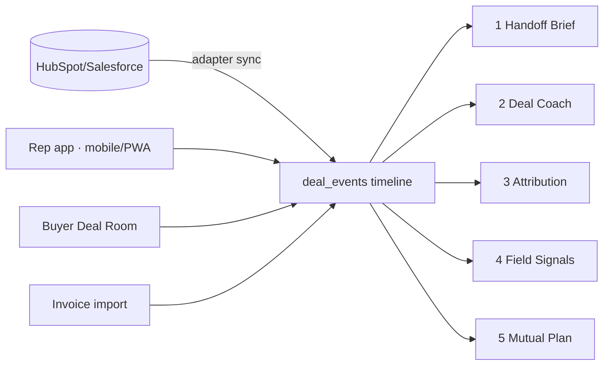

# VectorSales — Revenue Continuity Plan (v2)
_Master Prompt v2 (premium experience + performance) and Mobile-First addendum applied; AI framework evaluation folded in._

## Context
VectorSales (repo `Cost-Comparison-Tool`) is a field-sales hub for an office/jan-san supply dealer in PA/NJ: prospecting + map, CLIP-based good/better/best cost comparison, quote builder, accounts with onboarding checklist, and invoice-based book of business. Confirmed direction: **multi-tenant SaaS for independent dealers**; reps' discovery notes live in **Salesforce/HubSpot**.

The five enablement gaps share one root cause here: **the deal's history doesn't survive as data**. Quotes, catalog and lead notes live in each rep's `localStorage` (`frontend/store.js`); shared records are JSON blobs in SQLite (`accounts_store.py`); there is no event history. So nothing can be handed off (gap 1), surfaced in context (2), attributed (3), aggregated (4) or shared with a buyer (5). The plan fixes the foundation first, then builds all five on one spine: a **tenant-scoped deal timeline**.

Users are **field reps** — in a car, a client's breakroom, a supply closet — and **buyers** opening a link on their phone. Mobile is therefore a core, scored requirement, not a responsive afterthought.

Positioning (to validate in Phase 1): enterprise enablement suites are consolidating — Highspot announced a merger with Seismic in Feb 2026 — and target large sales orgs. Independent dealers with 5–50 reps are underserved. Wedge: **one continuous buyer plan from first cost comparison to first delivered order, attributed to real invoice revenue**, which DSR startups and enablement suites can't do because they don't own the quote, catalog or invoices.

## Current-state findings (verified in code)
| Area | Finding | Impact |
|---|---|---|
| Data | Quotes, catalog, activity in `localStorage`; accounts/leads as JSON blobs in SQLite on a 1 GB Render disk | Blocks all 5 gaps; data-loss risk |
| Tenancy | None; Office Basics specifics hard-coded in `backend.py` | Can't sell as SaaS |
| Auth | Users in `AUTH_USERS` env var (`auth.py`); no MFA/SSO/self-serve | One-team only |
| Backend | `backend.py` 1,227 lines (CLIP, OCR, reports, records); pending comparisons in memory | Hard to extend/test |
| Tests | **None** | Every change unverified |
| Frontend | Vanilla JS, ~78 KB gzipped across 16 scripts loaded without `defer`; 19 media queries; reduced-motion respected; distinctive design system (navy/brass, DM Serif + Plus Jakarta) | Good base; render-blocking scripts; no build step, types or component tests |
| Mobile | Viewport set, but no PWA manifest/service worker, no camera capture on product-photo upload, hover-styled controls, wide tables | Field use is second-class |
| Cost | torch + CLIP in the web process forces the Standard plan | Largest fixed cost |
| Good | Server-side permissions (`RecordStore._save_locked`), lockout, offline-tolerant sync (`sync.js`), unmatched-item `manual_lookup` signal, onboarding checklist, invoice-based YTD | Reuse all of it |

## Target architecture (modular monolith)
- **Postgres** (one DB) with `org_id` on every row + **Row-Level Security**; **pgvector** replaces FAISS + the JSON feedback store. Recommend **Supabase** (Postgres + Auth + Storage, already connected) behind thin `identity`/`storage` adapters; Clerk is the fallback if enterprise SSO is needed early.
- **FastAPI** split into domain modules: `identity`, `crm_core`, `quotes`, `catalog`, `comparison`, `content`, `timeline`, `signals`, `deal_room`, `integrations`, `billing`. Service interfaces only; no cross-module table access.
- **Background worker** on a Postgres-backed queue (`procrastinate`/`pgqueuer`; no Redis/Celery until measured need) for embeddings, OCR, CRM sync, AI jobs, reports. CLIP leaves the web process, so the web tier can shrink.
- **Object storage** (Supabase Storage or R2): private, signed URLs, malware scan on upload.
- **The spine — `deal_events`** (append-only, hash-chained per org): `{org_id, deal_id, account_id, actor, actor_type(user|buyer|system|ai), type, payload, source_ref, occurred_at}`.

## The five capabilities
**1. Handoff Brief (post-signature).** Structured discovery fields on the lead (pains, current supplier & contract end, decision-makers, promised prices/timelines, delivery constraints, success criteria), filled by the rep or AI-extracted from synced CRM notes **with a citation to each source note**; rep approves before it's final. On Won, an immutable versioned brief lands on the account; promises become dated commitments feeding a data-driven onboarding checklist (today's `ONBOARDING_STEPS` in `accounts.js`). CS must **Accept handoff**; the kickoff agenda hides questions already answered.

**2. Deal Coach (just-in-time).** Deterministic triggers first (stage, current supplier, segment, product line, objection tag) → battlecards, objection handlers, last-comparison talking points, cross-sell gaps (already computed in `accounts.js`), inside the deal bar and quote editor. Grounded Q&A over approved content later. Live call capture deferred: Pennsylvania is generally all-party consent for recording, so legal review first.

**3. Attribution (closed loop).** Versioned content library + tracked share links; comparisons, spend analyses, proposals and battlecard uses become timeline events. Revenue side = won quote value **plus subsequent invoice revenue** (same rule as `accounts_store.order_spend`). First/last/linear models as SQL views; labelled "influence," not causation.

**4. Field Signals (feedback up).** Typed signals (missing product, price, competitor sighting, feature request) auto-created from expanded `LOSS_REASONS` (`quotes.js`) and unmatched catalog items from `/compare/` and `/analysis/spend/`, weighted by $ volume. A board for purchasing/marketing/product with dedupe, owner, status; **closing a signal notifies the reps who raised it**. Outbound webhook/Slack.

**5. Deal Room / Mutual Action Plan.** Buyer portal via email-verified magic link: proposal & savings, mutual milestones (credit app, W-9, tax/resale certificate, PO, delivery setup), comments, uploads, acceptance via an ESIGN/UETA-designed signing step. **The same plan continues into onboarding**, joining gaps 1 and 5. Built phone-first because buyers open it from email.

## AI framework decisions (evaluated)
| Tool | Verdict | Where |
|---|---|---|
| **Hugging Face** | **Adopt now** (already used for CLIP) | Benchmark SigLIP + a text-embedding model vs. CLIP on past comparisons; small classifier for Field Signals; embeddings in pgvector; inference in worker or hosted endpoint |
| **LangGraph** | **Adopt in Phase 7, one workflow** | Handoff Brief: fetch notes → extract with citations → interrupt for rep approval → CS accept; Postgres checkpoints. Optional for Deal Room reminders |
| **LangChain** | **Optional** | Only where it removes code (structured output, model routing, retrieval); thin in-house wrapper is acceptable |
| **CrewAI** | **Don't adopt** | Narrow extract/classify/cite tasks don't need role-playing crews; overlaps LangGraph; revisit only for a measured open-ended research task |

Deterministic code only for pricing, margin, tax, attribution totals and permissions. Every agent: tenant-scoped retrieval, read-only tools, schema-validated output, human approval for anything customer-facing, prompt/model versioning, per-org cost caps, ~50-deal eval set before enablement. Customer data never used for training.

## Experience, mobile & performance (from attachments, adapted)
**Frontend decision.** Move from vanilla JS to **React + TypeScript built with Vite**, incrementally (new screens first: Deal Room, Signals board, Handoff; existing tabs migrated one at a time behind the same API). Rationale vs. the attachment's Next.js default: the app is fully authenticated (no SEO need), the backend is FastAPI, and a static Vite build keeps hosting on Cloudflare/FastAPI with no Node server to run or pay for. Revisit Next.js only if server rendering measurably improves Deal Room LCP on mobile. Marketing site: Astro later, separate responsibility.
- **Styling/components:** Tailwind with the **existing tokens ported** (navy/brass, DM Serif Display + Plus Jakarta Sans, light/dark), Radix primitives, shadcn/ui as owned code. Keep VectorSales' identity; don't adopt a generic dashboard look.
- **Motion:** CSS for state changes; Motion for drawers, panels and list transitions; respect `prefers-reduced-motion` (already done). GSAP/Lenis only on the future marketing site.
- **Not in the app:** Three.js/R3F, Babylon, PixiJS, OGL, Spline, WebGPU, Howler, Rapier/Cannon. Nothing in a sales workflow needs 3D, physics or sound; the map stays Google Maps (2D). An R3F/Spline product moment can be evaluated for the marketing site only.

**Mobile-first & native operability (scored requirement).**
- Every core workflow completable one-handed on a phone: log a visit, snap a competitor product (camera `capture` on upload → comparison), build/send a quote, tick onboarding, check a Deal Room.
- Touch targets ≥44 px, no hover-only actions, phone layouts for tables (card lists) and charts; smart defaults, autocomplete, address/phone from Maps.
- **PWA first** (manifest, service worker, offline queue extending `sync.js` to all record types, preserved drafts, install prompt). **Native (Expo) only if** pilots demand push notifications, biometric unlock or background location that a PWA can't deliver; it would reuse the same API, types and design tokens.
- Deal Room: no install, fast on a mid-range Android over 4G.

**Performance budgets (CI-enforced; targets are my proposals to validate).**
- Core Web Vitals at p75 real users (Google's thresholds): LCP ≤ 2.5 s, INP ≤ 200 ms, CLS ≤ 0.1.
- App shell ≤ 150 KB JS gzipped; route chunks ≤ 60 KB; Google Maps lazy-loaded only on the map card; fonts preloaded/subset (already self-hosted).
- Lighthouse CI + bundle-size check on every PR; web-vitals RUM to Sentry in production.

## Regulatory & security (readiness, not certification)
| Requirement | Applies | Key controls |
|---|---|---|
| CCPA/CPRA + state privacy laws | Likely (B2B contact data; thresholds to verify) | Data map, deletion/export, sub-processor list, DPA |
| GDPR/UK GDPR | Only with EU/UK dealers or contacts | Defer; geo-flag |
| CAN-SPAM | Yes (outreach drafts) | Keep opt-out line; server-side suppression list |
| ESIGN / UETA | Yes (Deal Room acceptance) | Consent, intent, audit trail, re-auth, retention |
| Call-recording consent | Only if call capture built | Deferred; legal review |
| Google Maps Platform terms | Yes | Place-data retention limits |
| SOC 2 Type I→II | Dealer procurement will ask | Build controls now; audit when revenue justifies |
| OWASP ASVS L2 / Top 10 | Yes | Threat model + tests |
| WCAG 2.2 AA | App + buyer portal | axe in CI, screen-reader passes on iOS/Android |

Top threats: cross-tenant leak, buyer-link forwarding/IDOR, prompt injection via CRM notes/buyer comments, malicious uploads, CRM token theft.

## Roadmap (each phase ships working, tested software)
| Phase | Scope | Exit criteria |
|---|---|---|
| **0 Safety net** (1–2 wk) | pytest + Playwright smoke; GitHub Actions CI; tighten CORS; `defer` scripts; split `backend.py` into modules, no behavior change | Existing flows covered; CI green |
| **1 Discovery** (parallel, 2 wk) | 8–10 dealer interviews incl. ride-alongs on phones; verify competitor features/prices; legal list | Top-2 gaps ranked by willingness to pay |
| **2 Foundation** (4–6 wk) | Postgres + RLS, orgs, managed auth + MFA, migrate localStorage/SQLite data, `deal_events`, audit log, worker, storage; **HF embedding benchmark + pgvector** | Cross-tenant tests pass; zero loss on migration dry-run; new embeddings ≥ CLIP accuracy |
| **3 Frontend foundation & PWA** (3–4 wk) | Vite/React/TS shell, Tailwind tokens, Radix/shadcn base, PWA + offline queue, camera capture, budgets in CI | Lighthouse mobile ≥ 90; CWV budgets met on test device |
| **4 Handoff + Signals** (3–4 wk) | Gaps 1 & 4 rules-only; data-driven onboarding | Won deal → accepted brief < 1 day in pilot |
| **5 Deal Room / MAP** (4–5 wk) | Gap 5 incl. e-sign and plan-into-onboarding | Pilot buyer completes plan on a phone |
| **6 Coach + Attribution** (4 wk) | Gaps 2 & 3; content library | Attribution reconciles to invoices |
| **7 CRM + AI** (4–6 wk) | HubSpot then Salesforce adapters; LangGraph handoff flow; signal classifier | Eval thresholds met per agent |
| **8 Commercial** (3 wk) | Entitlements (backend), Stripe behind adapter, self-serve org onboarding, Astro marketing site | First paid dealer |
| **9 Enterprise** | SSO/SCIM, SOC 2 audit, native app if justified — on demand | — |

Deliberately **not** built yet: live call coaching/extension, native app, 3D/WebGPU/physics/audio, Next.js server, Kubernetes/microservices, Redis/Celery, CrewAI, self-hosted LLMs, an LMS.

## Cost approach (estimates to verify; no vendor prices asserted)
- **A Dev:** local Docker + Postgres; free tiers; capped AI spend.
- **B Launch:** managed Postgres with point-in-time backups, small web instance, worker sized for embeddings, storage, Sentry, pay-per-use AI. Static frontend on Cloudflare (no Node hosting). Biggest lever: embeddings out of the web process.
- **C Growth:** read replica, worker pool, hosted vs. self-hosted embeddings decided by measured cost per comparison.
Track: compute + AI cost per active rep per month.

## Current scorecard (1–10, honest)
Industry opportunity 7 · Customer value 7 · Differentiation 6 · Functional completeness 6 · UX 7 · Visual quality 7 · **Accessibility 6** · **Performance 6** · **Mobile experience 5** · **Security 4** · **Regulatory readiness 3** · Safety 6 · **Architecture 4** · **AI 5** · **Integration 2** · **Cost efficiency 5** · **Scalability 3** · **Reliability 3** · Solo feasibility 7 · **Commercial readiness 2**.
Below-7 fixes: Phase 0 (architecture, reliability), 2 (security, scalability, cost, AI), 3 (mobile, performance, accessibility), 7 (integration), 8 (commercial), plus legal review (regulatory).

## Top risks
1. Migration loses browser-only data → importer, dry-run, rep-side export first (High/High).
2. Cross-tenant leak → RLS + per-endpoint tenant tests in CI (Med/Critical).
3. Frontend migration stalls features → strangler approach; new screens first, no big-bang rewrite (Med/High).
4. Dealers won't leave their CRM → CRM-first sync; VectorSales as companion (Med/High).
5. AI extraction errors → citations + mandatory rep approval (Med/Med).
6. E-sign legal sufficiency → counsel or signing vendor before launch (Low/High).
7. Solo bandwidth → strict phase gates; defer Phase 9.

## Before real customer data / before launch
- **Real data:** Postgres + RLS, MFA, encrypted backups with tested restore, audit log, CORS locked, DPA template, privacy policy, sub-processor list.
- **Launch:** tenant/permission suite, Deal Room pen-test, WCAG pass on real iOS/Android, CWV budgets met in RUM, backend entitlements, incident runbook, status page.

## Verification
- `pytest`: pricing/margin math, attribution sums, role permissions (rep/manager/CS/buyer), **cross-tenant tests for every endpoint**, migration dry-run on a copy of `sales_hub.db` + exported localStorage JSON.
- Playwright (desktop + Pixel/iPhone emulation): lead → camera comparison → quote → Deal Room accept as buyer → handoff accept → onboarding → order import → attribution shows the touches; offline: create a lead in airplane mode, reconnect, verify sync.
- Lighthouse CI + bundle budgets; axe accessibility; visual regression screenshots of key screens in light/dark.
- Real-device pass: one mid-range Android, one iPhone, one tablet on throttled 4G.
- AI evals: embedding top-1 match rate vs. confirmed feedback pairs; extraction precision/recall; zero uncited answers.
- Supabase `get_advisors` clean for security/RLS before pilot.

## After approval
Publish the full blueprint (now 42 deliverables incl. design system spec, performance budgets, accessibility strategy, mobile journeys) to the VectorSales project, then start Phase 0.

Sources: [GeekWire — Highspot/Seismic](https://geekwire.com/2026/seattle-based-highspot-is-merging-with-rival-seismic-in-major-sales-software-deal) · [Showpad DSR comparison](https://www.showpad.com/blog/best-digital-sales-room-platforms-a-ranked-comparison-2026) · [Prospeo MAP tools](https://prospeo.io/s/mutual-action-plan-software) · [LangChain/LangGraph 1.0](https://www.langchain.com/blog/langchain-langgraph-1dot0) · [CrewAI docs](https://docs.crewai.com/en/introduction.md)
